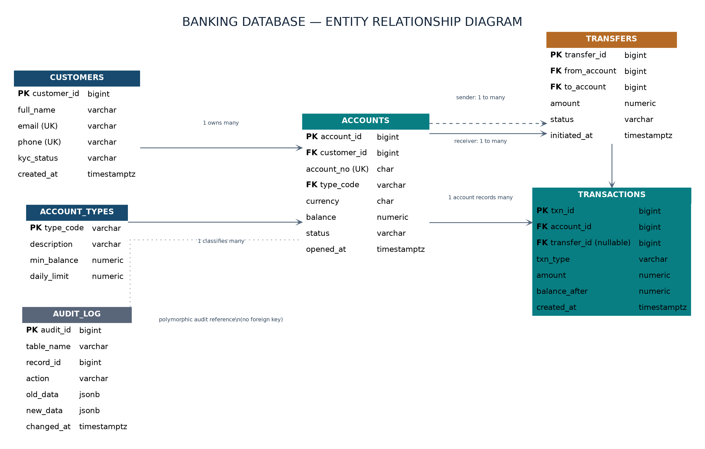
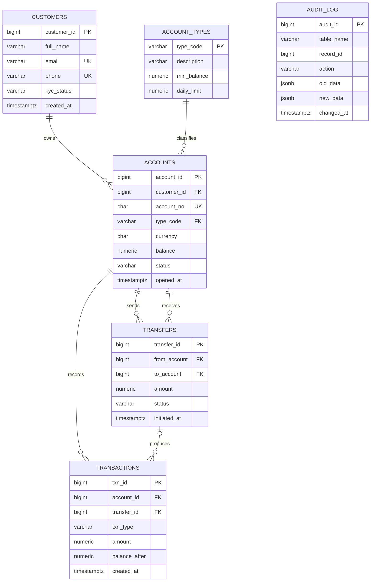

# Portfolio 1: Database Design and Modelling

## 1. Case study

**Organisation:** PayBridge Microfinance Bank (simulated organisation).

**Nature of the business/system:** A digital microfinance bank that lets customers open savings and current accounts, deposit and withdraw money, and transfer funds to other accounts.

**Users of the database:** Customers (via mobile/web app), tellers and customer-support staff, and internal auditors/compliance officers.

**Major data stored:** Customers and their KYC status, account products (account types), accounts and balances, transfers between accounts, individual ledger transactions, and an audit trail of changes.

**Key operations supported:**
- Open an account and verify a customer (KYC).
- Deposit and withdraw.
- Transfer funds between accounts, and reverse a failed transfer.
- Produce an account statement.
- Audit account balances against transaction history.

**Why a relational (ACID) database:** Money movement must be atomic, consistent, isolated and durable, so the ledger lives in PostgreSQL. Data that tolerates eventual consistency is modelled in NoSQL in Portfolio 4.

## 2. ER diagram



[View the PNG](er-diagram/banking_database_er_diagram.png) · [View the SVG](er-diagram/banking_database_er_diagram.svg)



`AUDIT_LOG` has no foreign keys on purpose: it records changes for any table and must survive even if the audited row is later changed.

**Relationships in words**
- One customer owns many accounts; each account belongs to one customer.
- One account type classifies many accounts.
- One account has many ledger transactions.
- A transfer has exactly one sending and one receiving account; an account can send or receive many transfers.
- A completed transfer produces two transactions (`TRANSFER_OUT` and `TRANSFER_IN`). If it is later reversed, two more rows are added (`REVERSAL_OUT` and `REVERSAL_IN`), so a transfer has at most four ledger rows. Deposits and withdrawals have no transfer, so `transactions.transfer_id` is nullable.

## 3. Relational schema, keys and constraints

Full DDL: [`schema.sql`](schema.sql).

| Table | Primary key | Foreign keys | Unique | CHECK constraints |
|---|---|---|---|---|
| customers | customer_id | none | email, phone | kyc_status in (PENDING, VERIFIED, REJECTED) |
| account_types | type_code | none | none | min_balance >= 0, daily_limit > 0 |
| accounts | account_id | customer_id, type_code | account_no | balance >= 0; status in (ACTIVE, FROZEN, CLOSED) |
| transfers | transfer_id | from_account, to_account | none | amount > 0; from_account <> to_account; status in (PENDING, COMPLETED, FAILED, REVERSED) |
| transactions | txn_id | account_id, transfer_id (nullable) | (transfer_id, txn_type) | amount > 0; balance_after >= 0; txn_type in (DEPOSIT, WITHDRAWAL, TRANSFER_OUT, TRANSFER_IN, REVERSAL_OUT, REVERSAL_IN); deposits and withdrawals must have no transfer_id, all other types must have one |
| audit_log | audit_id | none | none | action in (INSERT, UPDATE, DELETE) |

**Design choices**
- `NUMERIC(15,2)` for all money values, never floating point, to avoid rounding errors.
- Surrogate `BIGSERIAL` keys for entities; `type_code` is a natural key for the small reference table.
- Foreign keys use the default restrictive behaviour (no cascading deletes), because financial records must not disappear when a parent row is removed.
- `CHECK` constraints enforce business rules inside the database (no negative balances, no self-transfers, valid statuses), so every application path is protected.
- `TIMESTAMPTZ` so times are unambiguous across time zones.
- Secondary indexes are deliberately left out of this schema; they are added and measured in Portfolio 2.

## 4. Normalisation

**First normal form (1NF).** Every column holds a single atomic value, every table has a primary key, and there are no repeating groups. For example, a customer's accounts are rows in `accounts`, not a list stored in `customers`.

**Second normal form (2NF).** Every table has a single-column primary key, so no non-key attribute can depend on only part of a key.

**Third normal form (3NF).** No non-key attribute depends on another non-key attribute. The main example is `account_types`: `min_balance` and `daily_limit` depend on the account type, not on an individual account. Keeping them in `accounts` would repeat them on every row and create update anomalies (changing a limit would mean updating thousands of rows and risking inconsistency). Extracting them into `account_types` removes that redundancy. Likewise, transfer details live in `transfers` rather than being duplicated across the two ledger rows each transfer produces.

**Deliberate denormalisation**
- `accounts.balance` is derivable from the transaction history, but it is stored so balance checks are fast and so there is a single row to lock during concurrent transfers (relevant to Portfolio 3).
- `transactions.balance_after` stores a running balance snapshot so statements can be produced without recalculating history.
- `audit_log` stores row snapshots as JSONB so one table can audit any other table.

In each case the redundancy is intentional, and the risk is that the stored value drifts from the ledger. This is managed by updating balance and ledger rows inside a single transaction, and by an audit query that reconciles balances against transaction history.

**Possible future refinement:** `accounts.currency` could become a reference table if the bank supports multiple currencies with their own rules.

## 5. How to run and test

From the repository root, with the `pg-bank` container running:

```bash
docker exec -i pg-bank psql -U postgres -d paybridge < portfolio-1-database-design/schema.sql
docker exec -it pg-bank psql -U postgres -d paybridge -c "\dt"
docker exec -it pg-bank psql -U postgres -d paybridge -c "\d accounts"
```

## 6. Evidence

| File | Shows |
|---|---|
| [`screenshots/01-tables-list.png`](screenshots/01-tables-list.png) | All six tables created in the `paybridge` database |
| [`screenshots/02-accounts-structure.png`](screenshots/02-accounts-structure.png) | `accounts` columns, keys, CHECK and foreign key constraints |
| [`screenshots/03-transfer-reconciliation.png`](screenshots/03-transfer-reconciliation.png) | Reconciliation query written and run on the empty schema |
| [`screenshots/04-accounts-structure-repeat.png`](screenshots/04-accounts-structure-repeat.png) | `accounts` structure after a container restart |
| [`screenshots/05-schema-reload-constraints.png`](screenshots/05-schema-reload-constraints.png) | Updated schema reloaded; `transactions` now has `chk_txn_transfer_link` and `uq_txn_transfer_type` |
| [`screenshots/06-negative-balance-rejected.png`](screenshots/06-negative-balance-rejected.png) | Seed data loaded (20,000 customers, 30,000 accounts, 50,000 transfers, 190,800 transactions); setting a balance to -100 is rejected by `accounts_balance_check` |
| [`screenshots/07-transfer-reconciliation-seeded.png`](screenshots/07-transfer-reconciliation-seeded.png) | Reconciliation on the seeded data: no completed transfer is missing its two ledger rows (0 rows) |
| [`outputs/01-docker-setup.txt`](outputs/01-docker-setup.txt) | Starting PostgreSQL 16 in Docker |
| [`outputs/02-restart-and-list-tables.txt`](outputs/02-restart-and-list-tables.txt) | Container restart and table list |

## 7. Reflection

<!-- Reflection to be written -->
